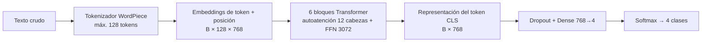
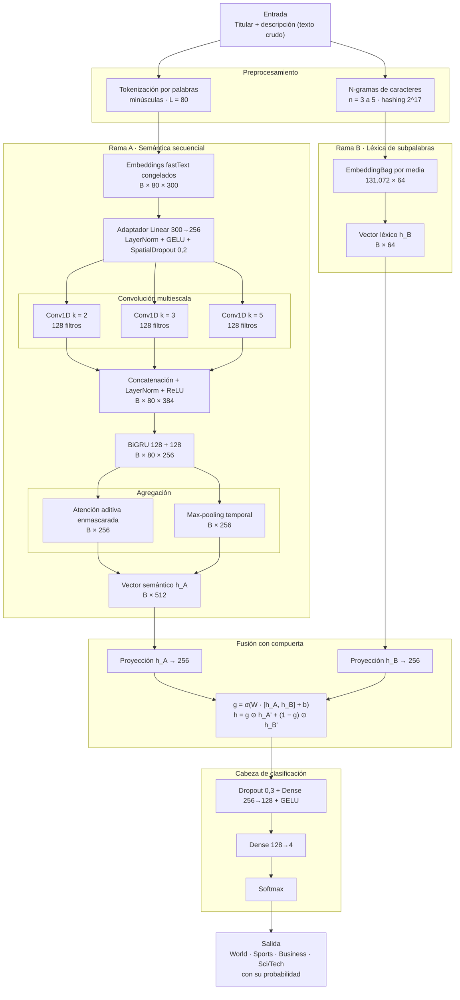
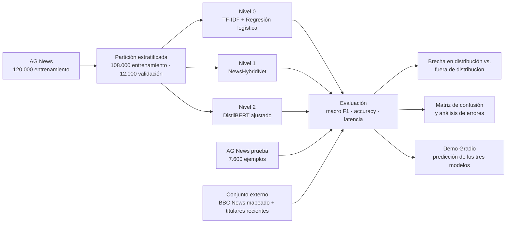

# Anteproyecto — Clasificador automático de noticias

**Curso:** Deep Learning · **Entrega preliminar** · Proyecto final
**Integrantes:** Emmanuel Alvarez, Samuel Herrera, Cristian Cabarcas

## 1. Título

**Clasificación automática de noticias con TF-IDF + Regresión Logística, una red neuronal híbrida propia (NewsHybridNet) y un Transformer ajustado (fine-tuning): evaluación de la generalización a fuentes no vistas en entrenamiento.**

## 2. Planteamiento del problema

Los medios publican miles de noticias al día y organizarlas por tema (deportes, negocios, ciencia/tecnología, mundo) de forma manual es lento y poco escalable. La clasificación automática de texto permite etiquetar, filtrar y recomendar contenido en tiempo real.

Un modelo puede obtener métricas muy altas en el conjunto de prueba de su propio dataset y aun así fallar con noticias de otros medios, porque cambian el estilo, el vocabulario y la estructura de los titulares. A esto se suma un desplazamiento temporal: AG News se construyó con noticias de mediados de la década de 2000, de modo que los titulares actuales contienen entidades, productos y eventos que el modelo nunca vio. Este proyecto no busca solo un buen accuracy: busca **comparar un enfoque clásico, una arquitectura neuronal diseñada por el grupo y un Transformer preentrenado, y medir de forma honesta si cada modelo generaliza fuera de la distribución de entrenamiento**.

**Pregunta de investigación.** ¿Cuánto del desempeño fuera de distribución se explica por el preentrenamiento contextual profundo (Transformer) y cuánto puede recuperarse con una arquitectura ligera que solo usa conocimiento léxico preentrenado (embeddings estáticos y n-gramas de caracteres)?

## 3. Objetivos

**Objetivo general**

Desarrollar y comparar un clasificador de noticias en cuatro categorías, basado en tres enfoques —una línea base clásica (TF-IDF + regresión logística), una arquitectura neuronal propia de doble rama (NewsHybridNet) y un modelo Transformer ajustado (DistilBERT)—, evaluando su desempeño, su costo computacional y su capacidad de generalizar a noticias de fuentes no vistas durante el entrenamiento.

**Objetivos específicos**

1. Construir una línea base (TF-IDF + regresión logística), diseñar y entrenar la arquitectura propia NewsHybridNet y ajustar un Transformer preentrenado sobre AG News, usando los mismos conjuntos de entrenamiento, validación y prueba para que la comparación sea justa.
2. Evaluar los modelos con macro F1, accuracy y tiempo de inferencia, y analizar los errores por clase (matriz de confusión y ejemplos mal clasificados).
3. Medir la generalización con un conjunto externo de noticias de fuentes distintas a las de entrenamiento, cuantificar el aporte del preentrenamiento mediante un estudio de ablación, y entregar una demo en la que el usuario ingresa un titular o texto y obtiene la categoría predicha.

## 4. Datos

| Aspecto | Descripción |
| --- | --- |
| Dataset | [AG News](https://huggingface.co/datasets/fancyzhx/ag_news) (`fancyzhx/ag_news`), derivado del corpus AG de más de 1 millón de artículos de más de 2.000 fuentes. |
| Tamaño | 120.000 ejemplos de entrenamiento y 7.600 de prueba (1.900 por clase). |
| Clases (4, balanceadas) | World (mundo/política), Sports (deportes), Business (negocios), Sci/Tech (ciencia y tecnología). |
| Campos | Texto (título + descripción) y etiqueta. |
| Idioma | Inglés. Todos los recursos preentrenados (embeddings y Transformer) deben ser de inglés. |

> **Nota:** AG News no tiene una clase "política" como tal. Las noticias políticas están dentro de **World**, por lo que se reporta así.

**Preprocesamiento y particiones**

- **Validación:** se separa un 10 % del entrenamiento (estratificado, semilla fija), lo que deja 108.000 ejemplos de entrenamiento y 12.000 de validación para ajustar hiperparámetros. El conjunto de prueba oficial solo se usa al final.
- **Línea base:** minúsculas, limpieza de caracteres especiales y vectorización TF-IDF con unigramas y bigramas.
- **NewsHybridNet:** minúsculas, tokenización por palabras conservando signos de puntuación relevantes, truncado o relleno a 80 palabras (cubre con holgura la longitud típica de titular + descripción en AG News), y extracción paralela de n-gramas de caracteres (n = 3 a 5) sobre el texto normalizado. El vocabulario de palabras se construye solo con la partición de entrenamiento.
- **Transformer:** se usa el tokenizador propio del modelo (WordPiece), con truncado y padding a una longitud máxima (~128 tokens, suficiente para titular + descripción). No se aplica limpieza agresiva, porque el Transformer aprovecha el texto original.
- **Data augmentation:** no se prevé de entrada, porque el dataset es grande y balanceado. Se evaluará solo si el análisis de errores lo justifica.

**Datos externos (reto de generalización)**

AG News no incluye la fuente de cada noticia, así que no se puede dividir por fuente dentro del propio dataset. Para probar la generalización se usará un conjunto externo de otras fuentes, por ejemplo **BBC News** (2.225 artículos en cinco categorías), con sus categorías mapeadas a las de AG News, además de titulares recientes recolectados por el grupo con etiquetado manual. La elección final del conjunto externo se confirmará al inicio de la experimentación.

| Categoría BBC | Categoría AG News | Observación |
| --- | --- | --- |
| business | Business | Equivalencia directa. |
| sport | Sports | Equivalencia directa. |
| tech | Sci/Tech | BBC *tech* es más estrecha (casi no incluye ciencia). |
| politics | World (condicional) | BBC *politics* trata sobre todo política interna del Reino Unido, mientras que World en AG News es mayoritariamente internacional. Se reportarán resultados **con y sin** esta clase. |
| entertainment | — | Sin equivalente; se excluye. |

Para los titulares recientes recolectados por el grupo, cada ejemplo será etiquetado de forma independiente por al menos dos integrantes; los desacuerdos se resolverán por discusión y se reportará el acuerdo entre anotadores (kappa de Cohen).

## 5. Arquitectura y modelos

El proyecto compara tres modelos que representan tres niveles de conocimiento previo:

| Nivel | Modelo | Conocimiento previo que aporta |
| --- | --- | --- |
| 0 | TF-IDF + regresión logística | Ninguno: todo se aprende de AG News. |
| 1 | **NewsHybridNet (propuesta del grupo)** | Léxico estático: embeddings de palabras fastText preentrenados y congelados. El resto de la red se entrena desde cero. |
| 2 | DistilBERT ajustado | Contextual profundo: toda la red está preentrenada sobre grandes corpus y se ajusta completa. |

Esta escalera permite atribuir la ganancia de desempeño (en distribución y fuera de ella) a cada tipo de conocimiento previo, en lugar de comparar solo un modelo "clásico" contra uno "profundo".

### 5.1 Línea base — TF-IDF + regresión logística

TF-IDF representa cada texto como un vector disperso según la frecuencia de sus términos, y la regresión logística multiclase lo clasifica. Es rápida, interpretable (se pueden ver las palabras más influyentes por clase) y sirve de referencia para ver cuánto aporta realmente el Deep Learning.

### 5.2 Modelo de referencia del estado del arte — DistilBERT ajustado (fine-tuning)

Se parte de un modelo preentrenado de la librería Hugging Face (candidato principal: **DistilBERT** `distilbert-base-uncased`; alternativa: BERT-base) y se añade una cabeza de clasificación de 4 salidas sobre la representación del token `[CLS]`.

- **Arquitectura:** 6 bloques Transformer de codificador, dimensión oculta 768, 12 cabezas de atención, capa feed-forward de 3.072 unidades y aproximadamente 66 millones de parámetros; vocabulario WordPiece de 30.522 subpalabras.
- **Por qué un Transformer:** la autoatención captura contexto y significado más allá de la presencia de palabras, y el preentrenamiento sobre grandes corpus ayuda a generalizar a vocabulario y estilos que no aparecen en AG News.
- **Por qué DistilBERT:** según Sanh et al. (2019), es un 40 % más pequeño y un 60 % más rápido que BERT-base conservando cerca del 97 % de su desempeño en GLUE, lo que importa para la demo y para los recursos disponibles.
- **Modificaciones respecto al original:** capa de clasificación nueva de 4 clases, entrenada junto con el resto de la red (fine-tuning completo).

### 5.3 Arquitectura propuesta — NewsHybridNet

**NewsHybridNet** es una red neuronal de doble rama diseñada por el grupo específicamente para el problema de clasificación de noticias con desplazamiento de fuente y de época. Combina una **rama semántica secuencial** (embeddings estáticos preentrenados, convoluciones multiescala, BiGRU y atención) con una **rama léxica de subpalabras** (n-gramas de caracteres con *hashing*), y fusiona ambas mediante una **compuerta aprendida**.

#### 5.3.1 Motivación de diseño

El diseño responde a tres observaciones sobre el dominio:

1. **Los titulares son cortos y densos en señales locales.** Expresiones de dos a cinco palabras ("interest rates", "Champions League", "chip maker") suelen bastar para decidir la categoría. Las convoluciones 1D con varios tamaños de kernel capturan precisamente estos patrones locales (Kim, 2014).
2. **El orden y la composición también importan.** "Apple shares fall" (Business) frente a "Apple unveils new chip" (Sci/Tech) comparten entidad pero difieren en el predicado. Una BiGRU sobre los mapas convolucionales integra el contexto a lo largo de toda la secuencia (Cho et al., 2014), y una capa de atención aditiva (Bahdanau et al., 2015; Yang et al., 2016) aprende qué posiciones son decisivas.
3. **Fuera de distribución aparecen palabras nunca vistas.** Nombres de empresas, personas, productos y eventos posteriores a 2005 no están en el vocabulario de AG News. Dos mecanismos mitigan esto: (a) los embeddings fastText se mantienen **congelados**, de modo que las palabras raras del entrenamiento conservan su posición semántica general en lugar de sobreajustarse a AG News, y las palabras fuera del vocabulario reciben el vector que fastText compone a partir de sus subpalabras (Bojanowski et al., 2017); (b) la rama de n-gramas de caracteres reconoce fragmentos morfológicos (“-coin”, “bio-”, “-ware”) aunque la palabra completa sea nueva (Joulin et al., 2017).

#### 5.3.2 Descripción capa por capa

Notación: `B` = tamaño del lote, `L = 80` = longitud de la secuencia en palabras.

| # | Bloque | Configuración | Forma de salida | Parámetros entrenables (aprox.) |
| --- | --- | --- | --- | --- |
| **Rama A — semántica secuencial** | | | | |
| A1 | Embeddings de palabra | fastText inglés de 300 dimensiones, vocabulario de 30.000 palabras, **congelados**; OOV mediante composición por subpalabras | B × 80 × 300 | 0 (9,0 M congelados) |
| A2 | Adaptador | Linear 300→256 + LayerNorm + GELU; *spatial dropout* 0,2 | B × 80 × 256 | 78 K |
| A3 | Convolución multiescala | Tres Conv1D en paralelo (kernels 2, 3 y 5; 128 filtros cada uno; *padding* "same") | 3 × (B × 80 × 128) | 328 K |
| A4 | Concatenación | Concatenación por canales + LayerNorm + ReLU | B × 80 × 384 | 1 K |
| A5 | BiGRU | 1 capa, 128 unidades por dirección | B × 80 × 256 | 395 K |
| A6 | Agregación | Atención aditiva enmascarada (vector de contexto aprendido) ‖ max-pooling temporal | B × 512 | 33 K |
| **Rama B — léxica de subpalabras** | | | | |
| B1 | N-gramas de caracteres | n = 3 a 5 sobre el texto normalizado, *hashing* a 2¹⁷ = 131.072 cubetas | lista dispersa | 0 |
| B2 | EmbeddingBag | Tabla 131.072 × 64, agregación por media | B × 64 | 8,4 M (dispersos) |
| **Fusión y clasificación** | | | | |
| F1 | Proyecciones | h_A: 512→256; h_B: 64→256 | 2 × (B × 256) | 148 K |
| F2 | Compuerta | g = σ(W · [h_A, h_B] + b); h = g ⊙ h_A' + (1 − g) ⊙ h_B' | B × 256 | 148 K |
| C1 | Capa oculta | Dropout 0,3 + Dense 256→128 + GELU | B × 128 | 33 K |
| C2 | Salida | Dense 128→4 + Softmax | B × 4 | 0,5 K |
| | **Total** | | | **≈ 9,6 M entrenables** (≈ 1,2 M densos + 8,4 M en la tabla dispersa) y 9,0 M congelados |

> La tabla de la rama B es grande en número de parámetros pero barata en cómputo: en cada paso de entrenamiento solo se actualizan las filas correspondientes a los n-gramas presentes en el lote. La parte densa de la red, que concentra el cómputo, tiene alrededor de 1,2 millones de parámetros.

#### 5.3.3 Flujo de datos

1. El texto (titular + descripción) se normaliza y se divide en dos representaciones: una secuencia de 80 índices de palabra y una bolsa de índices de n-gramas de caracteres.
2. **Rama A:** cada palabra se convierte en su vector fastText congelado; el adaptador lo lleva a un espacio de 256 dimensiones propio de la tarea. Las tres convoluciones extraen patrones de 2, 3 y 5 palabras, que se concatenan y pasan a la BiGRU para integrar el contexto en ambas direcciones. La atención produce un resumen ponderado de la secuencia, y el max-pooling conserva la activación más fuerte de cada canal; ambos se concatenan en `h_A` (512 dimensiones).
3. **Rama B:** los n-gramas se promedian en un vector `h_B` de 64 dimensiones que actúa como una “huella léxica” del texto, robusta a palabras desconocidas.
4. **Fusión:** ambas representaciones se proyectan a 256 dimensiones y una compuerta sigmoide decide, por cada dimensión y por cada ejemplo, cuánto confiar en la señal semántica frente a la léxica. Se espera que, ante textos con muchas palabras fuera del vocabulario, la compuerta desplace peso hacia la rama B; esto se verificará analizando la distribución de `g` en datos en distribución y fuera de ella.
5. **Clasificación:** una capa oculta y una capa lineal producen los *logits* de las cuatro clases, que la función softmax convierte en probabilidades.

#### 5.3.4 Ventajas esperadas

- **Eficiencia:** del orden de 0,1 GFLOPs por ejemplo frente a unos 11 GFLOPs de DistilBERT con 128 tokens (estimación de orden de magnitud a partir del número de parámetros y la longitud de secuencia). Permite inferencia en CPU con latencia baja y una demo sin GPU.
- **Robustez léxica:** la combinación de embeddings congelados con composición por subpalabras y la rama de n-gramas de caracteres está pensada específicamente para el vocabulario nuevo del conjunto externo.
- **Interpretabilidad:** los pesos de atención indican qué palabras determinaron la predicción y los valores de la compuerta indican qué rama dominó; ambos pueden mostrarse en la demo.
- **Control experimental:** al ser una red diseñada por el grupo, permite ablaciones limpias (quitar una rama, descongelar embeddings, inicializarlos al azar) que no son posibles con un modelo cerrado como DistilBERT.

### 5.4 Diagrama de la arquitectura propuesta

**Flujo experimental completo del proyecto**

### 5.5 Comparativa: NewsHybridNet frente a DistilBERT

**Características técnicas y costo computacional**

| Criterio | NewsHybridNet (propuesta) | DistilBERT ajustado (estado del arte) |
| --- | --- | --- |
| Familia | CNN + RNN con atención y fusión de ramas | Transformer codificador |
| Parámetros totales | ≈ 18,6 M (9,6 M entrenables, de ellos 8,4 M dispersos) | ≈ 66 M, todos entrenables |
| Tamaño en disco (FP32) | ≈ 75 MB (incluye la tabla fastText del vocabulario) | ≈ 255 MB |
| Entrada | 80 palabras + bolsa de n-gramas | 128 subpalabras WordPiece |
| Complejidad dominante por capa | O(L · d²), lineal en la longitud | O(L² · d) en atención + O(L · d²) en feed-forward |
| Cómputo por ejemplo (estimado) | ≈ 0,1 GFLOPs | ≈ 11 GFLOPs |
| Paralelismo en GPU | Limitado por la recurrencia de la BiGRU | Alto: toda la secuencia se procesa a la vez |
| Inferencia en CPU | Adecuada para tiempo real | Viable, pero con mayor latencia |
| Tiempo de entrenamiento estimado (GPU tipo T4) | Pocos minutos por época | Del orden de decenas de minutos por época |
| Memoria GPU en entrenamiento | Baja (lotes de 128 sin problema) | Moderada a alta (lotes de 32, precisión mixta recomendada) |

> Las cifras de cómputo, tamaño y tiempo son estimaciones de diseño. Los valores reales de latencia se medirán con el protocolo de la sección 6.

**Ventajas y desventajas**

| | NewsHybridNet | DistilBERT |
| --- | --- | --- |
| **Ventajas** | Muy ligera y rápida; interpretable mediante atención y compuerta; robusta a palabras nuevas por diseño; permite ablaciones controladas; no depende de una GPU para servir. | Representaciones contextuales profundas; mayor accuracy esperada; conocimiento del mundo adquirido en el preentrenamiento; ecosistema maduro (Hugging Face). |
| **Desventajas** | Los embeddings estáticos no distinguen sentidos de una misma palabra; menor capacidad para relaciones de largo alcance; techo de accuracy previsiblemente inferior; más hiperparámetros de diseño que ajustar. | Costo de cómputo y memoria considerablemente mayor; el ajuste completo puede sobreajustar al estilo de AG News; menor interpretabilidad; el tokenizador fragmenta entidades nuevas en subpalabras poco informativas. |
| **Accuracy esperada en AG News** | ≈ 91–93 % (hipótesis basada en modelos CNN/RNN y fastText reportados en la literatura) | ≈ 94–95 % |
| **Comportamiento esperado fuera de distribución** | Caída moderada, amortiguada por la rama léxica; es la hipótesis principal a contrastar. | Caída menor en términos relativos, gracias al preentrenamiento contextual. |

### 5.6 Transfer learning frente a entrenamiento desde cero

| Aspecto | Desde cero (sin preentrenamiento) | Transfer learning parcial (NewsHybridNet) | Transfer learning completo (DistilBERT) |
| --- | --- | --- | --- |
| Qué se transfiere | Nada | Geometría léxica de los embeddings fastText | Pesos de toda la red (sintaxis, semántica y conocimiento del mundo) |
| Qué se entrena | Toda la red | Adaptador, convoluciones, BiGRU, atención, rama B y cabeza | Toda la red, incluida la cabeza nueva |
| Datos necesarios | Muchos; AG News basta en distribución, pero no garantiza vocabulario amplio | Moderados | Pocos para converger; AG News es más que suficiente |
| Riesgo de sobreajuste al estilo de origen | Alto | Medio (los embeddings congelados actúan como regularizador) | Medio: el ajuste completo puede borrar parte del conocimiento general |
| Costo | Bajo | Bajo | Alto |

Para aislar el efecto del preentrenamiento, NewsHybridNet se entrenará en tres variantes (estudio de ablación):

1. **Embeddings aleatorios entrenables** (entrenamiento completamente desde cero).
2. **Embeddings fastText congelados** (configuración propuesta).
3. **Sin rama B** (solo rama semántica), para medir el aporte de los n-gramas de caracteres fuera de distribución.

La diferencia entre las variantes 1 y 2, comparada con la diferencia entre la variante 2 y DistilBERT, responde directamente a la pregunta de investigación.

### 5.7 Por qué la arquitectura propuesta es adecuada y complementaria

- **Adecuada:** el problema consiste en textos cortos con fuerte señal léxica local, donde arquitecturas convolucionales y recurrentes con buenos embeddings han mostrado resultados competitivos en AG News a una fracción del costo de un Transformer.
- **Complementaria en lo experimental:** ocupa el nivel intermedio de la escalera de conocimiento previo y convierte la comparación "clásico contra Transformer" en un análisis gradual y explicativo.
- **Complementaria en lo práctico:** si su desempeño fuera de distribución se acerca al de DistilBERT, se convierte en la opción preferible para un despliegue con restricciones de latencia o sin GPU.
- **Complementaria en los errores:** al usar señales distintas (léxicas y locales frente a contextuales), se espera que se equivoque en ejemplos diferentes. Si el tiempo lo permite, se evaluará un ensamble por promedio de probabilidades de NewsHybridNet y DistilBERT.

### 5.8 Entrenamiento (previsto)

| Hiperparámetro | NewsHybridNet | DistilBERT |
| --- | --- | --- |
| Función de pérdida | Entropía cruzada con *label smoothing* 0,1 | Entropía cruzada |
| Optimizador | AdamW, lr 1e-3, *weight decay* 1e-2 (excepto LayerNorm y sesgos) | AdamW, lr ~2e-5, *weight decay* 1e-2 |
| Programación del lr | One-cycle o coseno con *warmup* | Lineal con *warmup* (6–10 % de los pasos) |
| Tamaño de lote | 128 | 32 |
| Épocas | 10–15 con *early stopping* (paciencia 3) | 2–4 con *early stopping* |
| Criterio de parada | Macro F1 de validación | Pérdida de validación |
| Regularización | *Spatial dropout*, dropout 0,3, recorte de gradiente a 1,0 | Dropout del modelo, recorte de gradiente a 1,0 |
| Hardware | GPU de Colab (también entrenable en CPU) | GPU de Colab, precisión mixta (FP16) |

Se guardarán las curvas de loss y métricas de entrenamiento y validación de todos los modelos para analizar sobreajuste y convergencia. Cada configuración se entrenará con tres semillas distintas y se reportará la media y la desviación estándar.

## 6. Evaluación

| Métrica | Para qué sirve |
| --- | --- |
| Macro F1 | Desempeño promedio sobre las cuatro clases, sin favorecer a ninguna. |
| Accuracy | Referencia general y comparación con la literatura. |
| Tiempo de inferencia | Costo por noticia (ms) en CPU y GPU, para medir el compromiso entre precisión y velocidad. |
| Brecha de generalización | Diferencia de macro F1 entre la prueba de AG News y el conjunto externo. |

**Protocolo de medición de latencia.** Lote de tamaño 1 y lote de tamaño 32, número de hilos de CPU fijo, 50 ejecuciones de calentamiento descartadas y mediana de 500 ejecuciones, incluyendo la tokenización.

**Análisis adicionales:**

- Matriz de confusión y errores típicos. Se espera confusión entre Business y Sci/Tech, y entre World y Business.
- Comparación de los tres modelos en el conjunto de prueba de AG News y en el conjunto externo.
- Caída de desempeño entre datos "en distribución" y "fuera de distribución" como medida de generalización.
- Significancia estadística de las diferencias entre modelos mediante la prueba de McNemar o intervalos de confianza por *bootstrap*.
- Ablaciones de NewsHybridNet (sección 5.6) y análisis de los valores de la compuerta en datos en distribución frente a fuera de distribución.
- Si hay tiempo: separar titular solo vs. titular + cuerpo para ver cuánto aporta el texto largo.

## 7. Demo

Interfaz sencilla (Gradio o Streamlit) en la que el usuario pega un titular o el cuerpo de una noticia y recibe la categoría predicha con su probabilidad. Mostrará en paralelo la predicción de los tres modelos con su tiempo de inferencia y, para NewsHybridNet, resaltará las palabras con mayor peso de atención y el peso relativo de cada rama según la compuerta.

## 8. Plan de trabajo

| Etapa | Actividad |
| --- | --- |
| 1 | Exploración del dataset, particiones y línea base TF-IDF + LR. Preparación de embeddings fastText y del conjunto externo. |
| 2 | Implementación y entrenamiento de NewsHybridNet (incluidas las ablaciones) y fine-tuning de DistilBERT; análisis de curvas de entrenamiento. |
| 3 | Evaluación en prueba y en el conjunto externo, pruebas de significancia, medición de latencia y análisis de errores. |
| 4 | Demo, informe de 3 páginas (PDF) y presentación de 15 minutos. |

**Fecha límite de informe y presentación:** miércoles 11 de noviembre de 2026.

## 9. Resultados esperados y riesgos

- **Esperado:** la línea base alcanza ~90–92 % de accuracy en AG News, NewsHybridNet ~91–93 % y el Transformer ~94–95 %. La diferencia debería crecer en el conjunto externo, que es donde se espera ver el aporte del preentrenamiento. Se espera además que NewsHybridNet reduzca la brecha de generalización respecto a la línea base gracias a su rama léxica, con un costo de inferencia muy inferior al de DistilBERT.
- **Riesgo 1:** el conjunto externo puede tener distinto balance de clases o definiciones de categoría distintas. *Mitigación:* reportar macro F1, documentar el mapeo de categorías y reportar resultados con y sin la clase *politics* de BBC.
- **Riesgo 2:** recursos de cómputo limitados. *Mitigación:* usar DistilBERT, longitud máxima de 128 tokens y, si hace falta, un subconjunto del entrenamiento. NewsHybridNet puede entrenarse incluso en CPU.
- **Riesgo 3:** el tiempo disponible antes de la entrega es corto para tres modelos con ablaciones y varias semillas. *Mitigación:* priorizar la configuración principal de cada modelo con una semilla; las semillas adicionales y las ablaciones se ejecutan en paralelo en la etapa 2 y se reportan en la medida en que se completen.
- **Riesgo 4:** el tamaño del conjunto de titulares recientes etiquetados a mano puede ser pequeño. *Mitigación:* reportar intervalos de confianza y usarlo como evidencia complementaria a BBC News, no como medida principal.

## 10. Referencias

- Bahdanau, D., Cho, K. y Bengio, Y. (2015). *Neural Machine Translation by Jointly Learning to Align and Translate*. ICLR.
- Bojanowski, P., Grave, E., Joulin, A. y Mikolov, T. (2017). *Enriching Word Vectors with Subword Information*. TACL.
- Cho, K. et al. (2014). *Learning Phrase Representations using RNN Encoder–Decoder for Statistical Machine Translation*. EMNLP.
- Devlin, J., Chang, M.-W., Lee, K. y Toutanova, K. (2019). *BERT: Pre-training of Deep Bidirectional Transformers for Language Understanding*. NAACL.
- Joulin, A., Grave, E., Bojanowski, P. y Mikolov, T. (2017). *Bag of Tricks for Efficient Text Classification*. EACL.
- Kim, Y. (2014). *Convolutional Neural Networks for Sentence Classification*. EMNLP.
- Sanh, V., Debut, L., Chaumond, J. y Wolf, T. (2019). *DistilBERT, a distilled version of BERT: smaller, faster, cheaper and lighter*. NeurIPS EMC² Workshop.
- Vaswani, A. et al. (2017). *Attention Is All You Need*. NeurIPS.
- Yang, Z. et al. (2016). *Hierarchical Attention Networks for Document Classification*. NAACL.
- Zhang, X., Zhao, J. y LeCun, Y. (2015). *Character-level Convolutional Networks for Text Classification*. NeurIPS.
